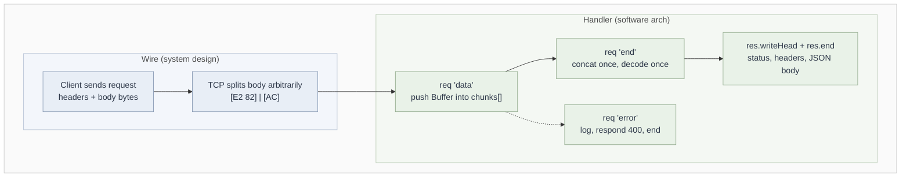

# Node.js: Handling Request Body Chunks (Buffers vs Strings)

## Core idea

**Chunks are bytes, not characters.** Accumulate bytes, then decode once at the end (or use a stateful decoder).

- `req` is a `Readable` stream. The `data` event fires once per chunk, and each chunk is a `Buffer` (raw bytes).
- TCP and stream boundaries are arbitrary. They fall between _bytes_, not between _characters_.
- UTF-8 characters are **1-4 bytes**, so a multi-byte character can be split across two chunks.

## The bug: `body += chunk`

`body += chunk` implicitly calls `chunk.toString()` on **each chunk independently**.

Worked example: `"€"` = bytes `E2 82 AC`

| Chunk | Bytes   | Decoded alone                  |
| ----- | ------- | ------------------------------ |
| 1     | `E2 82` | `�` (incomplete sequence)      |
| 2     | `AC`    | `�` (orphan continuation byte) |

Result: `"��"` instead of `"€"`. The data is permanently corrupted, because `�` (U+FFFD) is a lossy replacement and cannot be recovered afterwards.

## Request lifecycle



## Reference implementation (Buffer array, concat, decode once)

```javascript
import http from "http";

const server = http.createServer((req, res) => {
  const chunks = [];

  req.on("data", (chunk) => {
    // chunk is a Buffer (raw bytes), keep it as bytes for now.
    // Never `body += chunk`: that decodes each chunk separately and
    // corrupts multi-byte characters split across chunk boundaries.
    chunks.push(chunk);
  });

  req.on("end", () => {
    // Join all bytes first, then decode ONCE. Reuse the result.
    const body = Buffer.concat(chunks).toString();
    req.body = body;

    console.log("url:", req.url);
    console.log("method:", req.method);
    console.log("headers:", req.headers); // pass as a separate argument (a "+" would print [object Object])
    console.log("body:", body);

    res.writeHead(200, {
      "Content-Type": "application/json",
      author: "Gaurav",
      "Access-Control-Allow-Origin": "*", // hyphens, not underscores
    });

    res.end(JSON.stringify({ message: "hello world", body }));
  });

  req.on("error", (err) => {
    console.log("error:", err);
    if (!res.headersSent) {
      res.writeHead(400, { "Content-Type": "application/json" });
    }
    res.end(JSON.stringify({ error: "bad request" })); // always end the response
  });
});

server.listen(3000, () => {
  console.log("Server is up and running");
});
```

## `req` and `res` cheat sheet

| Thing                            | What it is                               | Notes                                                               |
| -------------------------------- | ---------------------------------------- | ------------------------------------------------------------------- |
| `req.url`                        | Path + query string (`/users?id=1`)      | Not the full URL; parse with `new URL(req.url, "http://localhost")` |
| `req.method`                     | `"GET"`, `"POST"`, ...                   | Always uppercase                                                    |
| `req.headers`                    | Plain object, **keys lowercased**        | Read with `req.headers["content-type"]`                             |
| `req.on("data")`                 | Fires per chunk (`Buffer`)               | Body is only available via the stream                               |
| `req.on("end")`                  | All body bytes received                  | Safe point to decode and respond                                    |
| `req.on("error")`                | Stream failed (e.g. client aborted)      | Without a listener, an unhandled `error` can crash the process      |
| `res.writeHead(status, headers)` | Sets status line and headers             | Must come before the body; call once                                |
| `res.end(data)`                  | Sends the body and finishes the response | **Required**, or the client hangs until timeout                     |

## Response rules

- **`writeHead` only queues the status and headers.** The response isn't complete until `res.end()` is called.
- **Header names are case-insensitive**, and `Access-Control-Allow-Origin` must use hyphens exactly. A misspelled name is sent as an unknown header and the browser ignores it silently.
- **`Content-Type: application/json`** tells the client how to parse the body. `JSON.stringify` the payload first.
- **`Content-Length` counts bytes, not characters.** If you set it manually, use `Buffer.byteLength(payload)`. `payload.length` is wrong for `"€"` (1 character, 3 bytes). It's the same bytes-vs-characters idea as chunking. With `res.end(string)` and no prior writes, Node sets it automatically.
- **CORS:** `Access-Control-Allow-Origin: *` allows simple cross-origin requests. Requests with custom headers or non-simple methods trigger an `OPTIONS` preflight, which needs `Access-Control-Allow-Methods` and `Access-Control-Allow-Headers` too.

## Alternative decoding approaches

### `req.setEncoding("utf8")`

```javascript
let body = "";
req.setEncoding("utf8");
req.on("data", (chunk) => (body += chunk)); // chunk is already a string
req.on("end", () => {
  /* body is intact */
});
```

Node attaches a `StringDecoder` internally. It holds incomplete trailing bytes until the next chunk arrives, so `+=` is safe.

### `StringDecoder` manually

```javascript
import { StringDecoder } from "string_decoder";

const decoder = new StringDecoder("utf8");
let body = "";
req.on("data", (chunk) => (body += decoder.write(chunk)));
req.on("end", () => {
  body += decoder.end();
}); // flush leftover partial bytes
```

Use it when processing text incrementally without holding raw bytes. `decoder.end()` is required to flush any buffered partial sequence.

### Async iteration

```javascript
const chunks = [];
for await (const chunk of req) chunks.push(chunk);
const body = Buffer.concat(chunks).toString();
```

Errors propagate through try/catch, which makes it the cleanest option in an `async` handler.

## Comparison

| Approach                | Memory              | Incremental text processing | Safe for split chars | Use when                           |
| ----------------------- | ------------------- | --------------------------- | -------------------- | ---------------------------------- |
| Buffer array + `concat` | Holds all raw bytes | No                          | Yes                  | Need the full body (JSON, form)    |
| `setEncoding("utf8")`   | Holds a string      | Yes                         | Yes                  | Text-only, simple handlers         |
| `StringDecoder`         | Holds a string      | Yes                         | Yes                  | Custom stream/parse pipelines      |
| `for await` + concat    | Holds all raw bytes | No                          | Yes                  | `async` handlers, clean error flow |
| `body += chunk` (naive) | Holds a string      | Yes                         | **No**               | Never                              |

## Production concerns

- **Size limit.** `chunks.push` is unbounded, so a client can exhaust memory. Track the running byte length. Past a cap (e.g. 1 MB), respond `413 Payload Too Large` and `req.destroy()`.
- **Parsing JSON.** Wrap `JSON.parse(body)` in try/catch and return `400` on failure. Check `Content-Type` before parsing.
- **Aborted requests.** If the client disconnects, the socket is gone and writing a response is pointless. Guard with `res.writableEnded` / `res.headersSent` before writing.
- **Charset.** `toString()` assumes UTF-8. A real server should honor the `Content-Type` charset or reject non-UTF-8.
- **Binary bodies.** For images and files, never decode. Keep `Buffer.concat(chunks)` as bytes.
- **Don't echo raw input blindly.** Reflecting the request body back is fine for a demo, but unsafe if it ever ends up in HTML.

## Interview one-liners

- **Why not `body += chunk`?** It decodes each chunk separately, so a character split across chunks becomes `�`.
- **How does `setEncoding` fix it?** An internal `StringDecoder` buffers incomplete trailing bytes between chunks.
- **Why must you call `res.end()`?** `writeHead` only sets the status and headers. The response isn't finished, and the client keeps waiting, until `end()`.
- **Why does `req.headers` print `[object Object]` when concatenated to a string?** It's an object, and `+` calls its default `toString()`. Pass it as a separate `console.log` argument.
- **When do you skip decoding?** For binary payloads, or when passing bytes straight through to another stream or disk.
