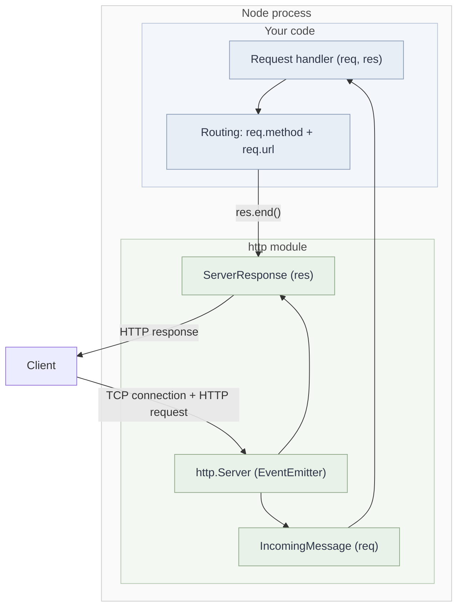
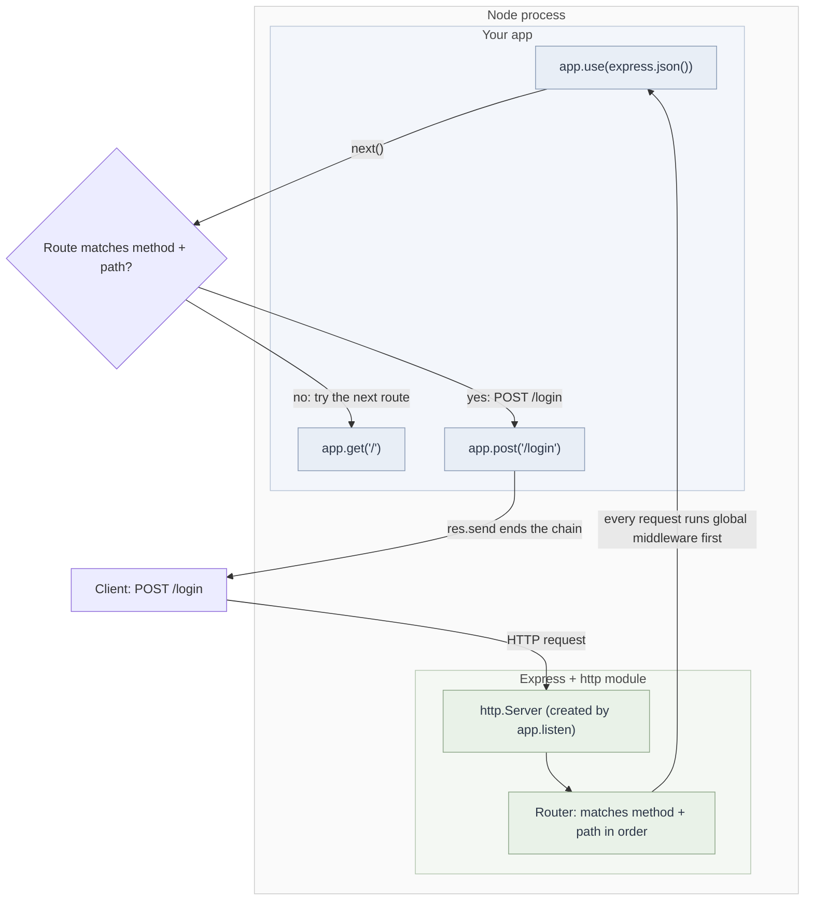

# Node.js `http` Module

## Overview

The `http` module is Node's built-in implementation of the HTTP/1.1 protocol. It creates a server that listens on a TCP port and emits a `request` event for every incoming HTTP request. It provides raw request and response objects and nothing else: routing, body parsing, and middleware are left to your code. Frameworks like Express are built on top of it.

## Core Objects

| Object   | Type              | What it holds                                                                                                  |
| -------- | ----------------- | -------------------------------------------------------------------------------------------------------------- |
| `server` | `http.Server`     | An EventEmitter. Emits `request`, `upgrade`, `connection`, `error`, `close`.                                   |
| `req`    | `IncomingMessage` | A Readable stream. Has `req.method`, `req.url`, `req.headers` (lowercase keys), and the body as stream chunks. |
| `res`    | `ServerResponse`  | A Writable stream. Has `res.statusCode`, `res.setHeader()`, `res.writeHead()`, `res.write()`, `res.end()`.     |

## Mechanism



### Minimal server

```js
import http from "http";

const PORT = 3000;

const server = http.createServer((req, res) => {
  // Called once per request, on the event loop
  res.statusCode = 200; // default is already 200
  res.setHeader("Content-Type", "text/plain"); // tells the client how to read the body
  res.end("Hello from Node"); // writes the body and finishes the response
});

server.listen(PORT, () => {
  console.log(`listening on ${PORT}`);
});
```

### Manual routing

```js
const server = http.createServer((req, res) => {
  if (req.method === "GET" && req.url === "/") {
    res.end("home");
  } else if (req.method === "GET" && req.url === "/about") {
    res.end("about");
  } else {
    res.statusCode = 404;
    res.end("404: Not found");
  }
});
```

`req.url` includes the query string, so `/about?x=1` does not match `/about`. Parse it first:

```js
const url = new URL(req.url, `http://${req.headers.host}`); // base needed because req.url is a path only
url.pathname; // "/about"
url.searchParams.get("x"); // "1"
```

### Reading a request body

The body arrives as a stream of chunks. Collect the chunks and parse after `end`:

```js
let body = "";
req.on("data", (chunk) => {
  // called once per chunk (Buffer)
  body += chunk; // Buffer coerces to string on concatenation
});
req.on("end", () => {
  // the full body has arrived
  const data = JSON.parse(body); // throws if the client sent invalid JSON
  res.end("received");
});
```

### Response order rules

```js
res.writeHead(201, { "Content-Type": "application/json" }); // status and headers in one call
res.end(JSON.stringify({ ok: true }));
```

Headers must be set before the first `res.write()` or `res.end()`. Setting a header after that throws `ERR_HTTP_HEADERS_SENT`.

### Startup errors

```js
server.on("error", (err) => {
  if (err.code === "EADDRINUSE") {
    console.error(`port is in use`); // another process already holds the port
  }
});
```

### WebSocket upgrade

A WebSocket connection begins as a normal HTTP request with `Upgrade: websocket`. Node emits a separate `upgrade` event for it, and the `request` handler does not run:

```js
server.on("upgrade", (req, socket, head) => {
  // req.headers.upgrade === "websocket"
  // socket is the raw TCP socket. Responding with HTTP 101 (Switching Protocols)
  // turns it into a persistent bidirectional tunnel. A library such as `ws` usually handles this step.
});
```

## Worked Example: One Request, Step by Step

| Step | What happens                                                                       |
| ---- | ---------------------------------------------------------------------------------- |
| 1    | Client opens TCP connection to port 3000                                           |
| 2    | Client sends `GET /about HTTP/1.1` with headers                                    |
| 3    | `http.Server` emits `request`, passing `req` and `res`                             |
| 4    | Handler reads `req.method` and `req.url`, selects a branch                         |
| 5    | Handler sets status and headers, then calls `res.end()`                            |
| 6    | Node writes the response; with keep-alive, the TCP connection stays open for reuse |

## Event Loop Note

Node runs your handler on a single thread. If the handler runs CPU-heavy code, such as a large synchronous loop or `JSON.parse` on a huge payload, every other request waits. Keep handlers non-blocking, and move heavy computation to worker threads or a separate service.

## Best For

- Learning how HTTP works underneath frameworks
- Small services with few routes and no need for middleware
- Custom protocol work, such as WebSocket upgrades
- Lightweight tools where a framework's dependency tree isn't worth it

## Trade-offs

| Aspect          | `http`                                                            |
| --------------- | ----------------------------------------------------------------- |
| Dependencies    | None                                                              |
| Overhead        | Minimal, nothing between the request and your code                |
| Routing         | Manual `if/else` chain, grows hard to maintain                    |
| Body parsing    | Manual `data` and `end` events on every POST                      |
| Middleware      | Not provided. Logging, auth, and CORS are wired by hand per route |
| Error isolation | An uncaught exception in a handler can crash the process          |

✅ Full control over status codes, headers, and streams
✅ Easy to see exactly what is sent on the wire
❌ Repetitive boilerplate across routes
❌ No shared pipeline for cross-cutting concerns

**Multi-instance behavior:** each Node process has its own memory. Module-level variables used for sessions or rate limits are not shared when several instances run behind a load balancer. Use an external store such as Redis.

## vs Sibling Concept: Express

|                 | `http`                     | Express                              |
| --------------- | -------------------------- | ------------------------------------ |
| Routing         | `if/else` on `req.url`     | `app.get(path, handler)`             |
| Body parsing    | Manual `data`/`end` events | `app.use(express.json())`            |
| Shared behavior | Repeated in every branch   | `app.use(middleware)` once           |
| Error handling  | Manual try/catch           | Error middleware with four arguments |

Express calls `http.createServer` internally, so everything in this note still applies underneath it.

## Interview Soundbite

Node's `http` module is the built-in implementation of the HTTP protocol. It emits a `request` event for each incoming request and gives you raw readable and writable streams for the request and response. Routing, body parsing, and middleware are left to you, which is why frameworks like Express exist.

---

# Express

## Overview

Express is a routing and middleware layer on top of Node's `http` module. It adds three things: declarative routes with `app.get`/`app.post`, a middleware pipeline with `app.use`, and a way to add routes without editing existing handlers. The request and response objects are the same `req` and `res` from `http`, extended with helper methods.

## Core Concepts

| Concept       | Signature                           | Role                                                    |
| ------------- | ----------------------------------- | ------------------------------------------------------- |
| Route         | `app.METHOD(path, handler)`         | Runs when method and path match                         |
| Middleware    | `app.use(fn)` or `(req, res, next)` | Runs for every request, or for the path it's mounted on |
| `next()`      | Called inside middleware or handler | Passes control to the next matching item                |
| Error handler | `(err, req, res, next)`             | Four arguments. Catches errors from earlier items       |

## Mechanism



## Code

```js
import express from "express";

const app = express();
const PORT = 3000;

app.use(express.json()); // parses JSON bodies into req.body for routes registered after this line

app.get("/", (req, res) => {
  res.send("Welcome to home page"); // string: Content-Type text/html
});

app.get("/contact", (req, res) => {
  res.send("Welcome to contact page");
});

app.post("/login", (req, res) => {
  console.log(req.body); // { username: 'gaurav', password: 'secret123' } with the curl below
  res.send("Login received successfully!");
});

app.listen(PORT, () => {
  console.log(`Server is running on port: ${PORT}`);
});
```

Test with:

```bash
curl -X POST http://localhost:3000/login \
  -H "Content-Type: application/json" \
  -d '{"username": "gaurav", "password": "secret123"}'
```

## Worked Example: Why Order Matters

```js
// Broken: the parser is registered after the route
app.post("/login", (req, res) => {
  console.log(req.body); // undefined, because the parser hasn't run for this route yet
});
app.use(express.json());

// Correct: the parser is registered first
app.use(express.json());
app.post("/login", (req, res) => {
  console.log(req.body); // parsed object
});
```

Express runs items in registration order, so a parser must come before any route that reads its output.

## Middleware and `next()`

```js
app.use((req, res, next) => {
  console.log(req.method, req.url); // e.g. "POST /login"
  next(); // passes control on. If omitted and nothing sends a response, the request hangs
});
```

## Response Helpers

| Call                        | Effect                                              |
| --------------------------- | --------------------------------------------------- |
| `res.send("text")`          | Content-Type `text/html`                            |
| `res.send({ ok: true })`    | Serialized as JSON, Content-Type `application/json` |
| `res.json({ ok: true })`    | Same as above, explicit                             |
| `res.status(201).json(...)` | Chainable status code                               |
| `res.redirect("/")`         | 302 by default                                      |

## Error Handling

```js
app.use((err, req, res, next) => {
  // four arguments marks this as an error handler
  console.error(err);
  res.status(500).send("Something went wrong");
});
```

Register this after the routes. Errors thrown in handlers, or passed to `next(err)`, skip ordinary middleware and land here. In Express 4, a rejected promise from an async handler is not caught automatically and needs `next(err)` or a wrapper. Express 5 forwards those rejections to the error handler.

## Trade-offs

| Aspect            | Express                                                                                         |
| ----------------- | ----------------------------------------------------------------------------------------------- |
| Routing           | Declarative, easy to scan                                                                       |
| Shared behavior   | Middleware written once, reused across routes                                                   |
| Ecosystem         | Large set of middleware packages                                                                |
| Transparency      | Hides the raw stream. Debugging parsing problems requires knowing what `http` does underneath   |
| Order sensitivity | Middleware order is implicit. Moving a line can silently break routes                           |
| Versioning        | Express 4 and 5 differ in async errors and path matching. Check the version before copying code |

✅ Routes and middleware are composable and readable
✅ Standard structure other developers recognize
❌ Behavior depends on registration order
❌ Abstraction can hide what happens at the `http` level

**Multi-instance behavior:** same as raw `http`. Memory in `app.locals` or module-level variables is per process, so shared state needs an external store.

## vs Sibling Concept: Raw `http`

|                 | `http`                     | Express                              |
| --------------- | -------------------------- | ------------------------------------ |
| Routing         | `if/else` on `req.url`     | `app.get(path, handler)`             |
| Body parsing    | Manual `data`/`end` events | `app.use(express.json())`            |
| Shared behavior | Repeated in every branch   | `app.use(middleware)` once           |
| Error handling  | Manual try/catch           | Error middleware with four arguments |

## Interview Soundbite

Express is a routing and middleware layer on top of Node's `http` module. Routes are registered with `app.get` and `app.post`, and middleware with `app.use`. Each function either sends a response or calls `next()` to pass control to the next match, and the same `req` and `res` objects from `http` underlie all of it.
