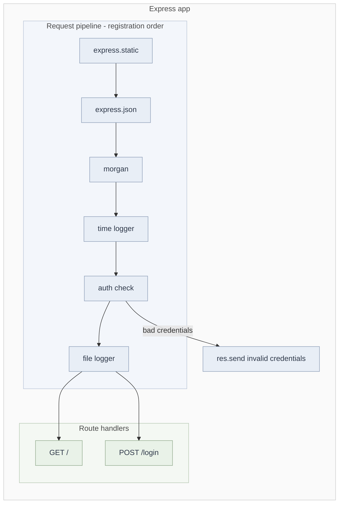

# Express Middleware (with EJS and Morgan)

## 1. What middleware is

A middleware is a function that runs **between the incoming request and the final response**. It receives `(req, res, next)` and can:

- read or modify `req` and `res`
- end the request-response cycle (`res.send`, `res.json`, `res.end`)
- hand control to the next function by calling `next()`

If a middleware neither responds nor calls `next()`, the request **hangs**.

```javascript
app.use((req, res, next) => {
  console.log(req.method, req.url);
  next(); // pass control on
});
```

## 2. How `next()` knows what comes next

Express keeps an **ordered stack** of layers (every `app.use`, `app.get`, `app.post` adds one). On each request, the router walks the stack with an index. `next` is a **closure** over that index: calling it increments the index and runs the next layer whose path and method match.

This is the same closure idea as before: `next` remembers state (the current position) from the scope where it was created.



## 3. Types of middleware

| Type              | Registered with                                              | Example                    | Notes                                                                           |
| ----------------- | ------------------------------------------------------------ | -------------------------- | ------------------------------------------------------------------------------- |
| Application-level | `app.use(fn)` or `app.METHOD(path, fn)`                      | time logger, auth check    | Runs for every request, or for a path or method if specified                    |
| Router-level      | `router.use(fn)`                                             | per-feature auth           | Same as application-level, bound to an `express.Router()` instance              |
| Error-handling    | `app.use((err, req, res, next) => {})`                       | central error responder    | **Four arguments**; Express identifies it by arity; must be registered **last** |
| Built-in          | `express.json()`, `express.static()`, `express.urlencoded()` | body parsing, static files | Ship with Express                                                               |
| Third-party       | `app.use(morgan("combined"))`                                | `morgan`, `cors`, `helmet` | Installed from npm                                                              |

`morgan` is **third-party**, not built-in.

## 4. The built-ins used here

| Middleware                 | What it does                                                        | Gotcha                                                                                                                           |
| -------------------------- | ------------------------------------------------------------------- | -------------------------------------------------------------------------------------------------------------------------------- |
| `express.static("public")` | Serves files from `public/` by URL path                             | Registered before auth, so everything in `public/` is **unauthenticated**                                                        |
| `express.json()`           | Parses bodies with `Content-Type: application/json` into `req.body` | No matching header means no parsing                                                                                              |
| `morgan("combined")`       | Logs each request in Apache combined format                         | Logs when the response finishes; register it before anything that can end the response early so rejected requests are logged too |

## 5. `req.body` in Express 5

In Express 5, `req.body` is **`undefined`** unless a body parser actually parsed something. (In Express 4 it defaulted to `{}`.)

So `req.body.username` throws a `TypeError` for:

- a browser GET (no body)
- the automatic `/favicon.ico` request
- a POST without `Content-Type: application/json`
- an empty body

Safe version:

```javascript
app.use((req, res, next) => {
  if (req.body?.username === username && req.body?.password === password) {
    return next();
  }
  res.status(401).send("invalid credentials");
});
```

Notes:

- A browser GET cannot carry a JSON body, so body-based credentials can never authenticate a browser GET. For GET routes, send credentials in a header (`Authorization`) or use a session or cookie.
- Use `return next()` or an `else`, so no code runs after `next()` by accident.
- Use `401` for failed authentication instead of the default `200`.

## 6. Why the curl test works

```
curl -X POST http://localhost:3000/login -H "Content-Type: application/json" -d "{\"username\":\"gaurav123\",\"password\":\"gaurav123\"}"
```

1. `Content-Type: application/json` lets `express.json()` parse the body, so `req.body = { username, password }`.
2. `express.json()` is registered **before** the auth check, so the body is already parsed when the auth check reads it.
3. Each middleware calls `next()`, so the request reaches `app.post("/login")`.

Without the header, `req.body` stays `undefined` and the auth middleware throws. If `express.json()` were registered after the auth check, the result would be the same.

## 7. Order is behavior

Middleware runs **top to bottom in registration order**. Rules of thumb:

1. Body parsers go before anything that reads `req.body`.
2. Logging goes early, so rejected requests are still logged.
3. Auth goes before the routes it protects.
4. Static files go before auth only if they are meant to be public.
5. The error-handling middleware goes last.

`app.use(fn)` with no path runs for **every method and every route**. That is why the auth check above also guards `GET /`.

## 8. `next()` variants

| Call             | Effect                                                                                                   |
| ---------------- | -------------------------------------------------------------------------------------------------------- |
| `next()`         | Go to the next matching middleware or route                                                              |
| `next(err)`      | Skip everything normal and jump to the error-handling middleware                                         |
| `next("route")`  | Skip the remaining handlers of the current route (only works in `app.METHOD` / `router.METHOD` handlers) |
| `next("router")` | Exit the current router and continue in the parent                                                       |

In **Express 5**, a rejected promise or a thrown error in an `async` handler is forwarded to `next(err)` automatically. In Express 4 you had to wrap async handlers yourself.

```javascript
app.get("/products", async (req, res) => {
  const data = await fs.promises.readFile("data.json", "utf-8"); // rejection -> error handler
  res.json(JSON.parse(data));
});
```

## 9. File logger middleware

```javascript
app.use((req, res, next) => {
  fs.appendFile(
    "log.txt",
    `${username} visited at ${Date.now()} using ${req.method} on ${req.url}\n`,
    (err) => (err ? console.log(err) : console.log("success..")),
  );
  next();
});
```

- Use `appendFile`. `writeFile` **overwrites** the file on every request, so only the last visit survives.
- The `\n` keeps each entry on its own line.
- The write is asynchronous. `next()` runs immediately and does not wait for the write, which is fine for logging.
- `log.txt` is created relative to the **working directory** the server was started from.

## 10. Serving HTML

| Approach                                         | Problem                                                                                                                                    |
| ------------------------------------------------ | ------------------------------------------------------------------------------------------------------------------------------------------ |
| `fs.readFile("home.html")` then `res.send(data)` | Re-reads the file on every request, no dynamic data, easy to get error handling wrong (`return err` inside a callback does nothing useful) |
| `res.sendFile(path)`                             | Fine for fully static pages                                                                                                                |
| **EJS templates with `res.render`**              | Dynamic HTML on the server                                                                                                                 |

### EJS

**What it is:** a server-side templating engine. You write HTML with embedded JavaScript, and the server fills in data and sends finished HTML.

**Setup:**

```javascript
app.set("view engine", "ejs"); // Express loads the ejs package itself
// default views folder is ./views, relative to the working directory

app.get("/", (req, res) => {
  res.render("home", { name: "Gaurav" }); // views/home.ejs
});
```

You do **not** need `import ejs from "ejs"`. Express requires it internally. The package only needs to be installed.

**Tags:**

| Tag              | Meaning                                         |
| ---------------- | ----------------------------------------------- |
| `<%= value %>`   | Output, HTML-escaped (safe default)             |
| `<%- value %>`   | Output, raw (only for trusted HTML)             |
| `<% code %>`     | JavaScript with no output (loops, conditionals) |
| `<%# comment %>` | Comment                                         |

```html
<h1>Hello, <%= name %></h1>
<ul>
  <% items.forEach(item => { %>
  <li><%= item %></li>
  <% }) %>
</ul>
```

**When to use it:** server-rendered pages, admin panels, email templates, small apps where a JS framework is overkill. For highly interactive UIs, use a client-side framework (React) and have Express serve JSON.

|               | EJS                      | React                                         |
| ------------- | ------------------------ | --------------------------------------------- |
| Renders on    | Server, per request      | Browser (or server with SSR)                  |
| Output        | Finished HTML string     | Component tree updated through reconciliation |
| Interactivity | Needs separate client JS | Built in                                      |
| Data flow     | `res.render(view, data)` | Props and state                               |

## 11. Common failure checklist

| Symptom                                                    | Cause                                                                                                      |
| ---------------------------------------------------------- | ---------------------------------------------------------------------------------------------------------- |
| `Cannot read properties of undefined (reading 'username')` | `req.body` undefined: no body, wrong or missing `Content-Type`, or parser registered after this middleware |
| Request hangs forever                                      | Middleware neither responded nor called `next()`                                                           |
| `Cannot use import statement outside a module`             | Missing `"type": "module"` in `package.json`                                                               |
| `Failed to lookup view "home"`                             | `views/home.ejs` missing, or server started from a different folder                                        |
| `log.txt` has only one line                                | Used `writeFile` instead of `appendFile`                                                                   |
| `Cannot set headers after they are sent`                   | Responded and then also called `next()`, or responded twice                                                |

## 12. Interview angles

- **Define middleware** in one sentence and state the `(req, res, next)` signature.
- **Explain `next`** as the router advancing an index through an ordered stack, held in a closure.
- **Why is order significant?** Registration order is execution order.
- **How does Express recognize error middleware?** By its four parameters.
- **What changed in Express 5?** `req.body` is `undefined` by default, async errors are forwarded automatically, and the path syntax changed (wildcards must be named, for example `/*splat`).
- **Security notes:** hard-coded credentials, credentials in a request body, and unauthenticated static files are all things to call out.
