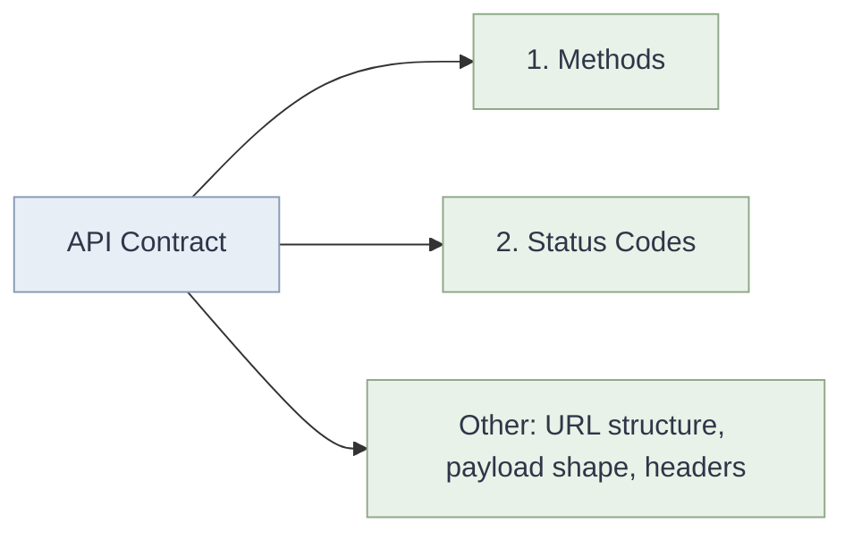

# RESTful APIs — Contracts, Methods & Status Codes

## 1. What REST Actually Is

REST (Representational State Transfer) is **not a protocol** and **not an API**. It is an **architectural style**: a set of design principles, essentially a rulebook for how APIs should be designed.

| Term     | What it is                                             | Example                                                    |
| -------- | ------------------------------------------------------ | ---------------------------------------------------------- |
| Protocol | Strict wire-level rules for communication              | HTTP, TCP, SMTP                                            |
| API      | An interface exposing functionality/data               | `/users`, `/orders`                                        |
| REST     | A set of design principles for building APIs over HTTP | Resource-based URLs, correct methods, correct status codes |

An API that follows these principles is called **RESTful**.

---

## 2. Prerequisite: the Contract

A **contract** is an agreement between two parties (A and B) on **how data will be shared**.

**Analogy: offer letter**

- You receive an offer letter and sign it.
- By signing, you agree to the company's conditions, and the company agrees to its side.
- Neither party can arbitrarily change the terms afterward.

An **API contract** works the same way:

- **Client (A)** and **Server (B)** agree on the shape of requests and responses.
- Both sides can then build and test independently, trusting the other to honor the agreement.

---

## 3. What an API Contract Specifies



### 3.1 Respect the HTTP Methods

| Method   | Intent                      | Idempotent     | Safe |
| -------- | --------------------------- | -------------- | ---- |
| `GET`    | Read a resource             | Yes            | Yes  |
| `POST`   | Create a resource           | No             | No   |
| `PUT`    | Replace/update a resource   | Yes            | No   |
| `PATCH`  | Partially update a resource | Not guaranteed | No   |
| `DELETE` | Remove a resource           | Yes            | No   |

**Why not just use `POST` for everything?**
Technically `POST` _can_ carry any operation, but doing so breaks the contract:

- **Semantics are lost.** Nobody can tell what an endpoint does from its method.
- **Caching breaks.** Browsers, CDNs and proxies cache `GET` responses; they never cache `POST`.
- **Safe retries break.** Clients and proxies can auto-retry idempotent methods (`GET`, `PUT`, `DELETE`) after a network failure. With `POST`, a retry may create duplicates.
- **Tooling breaks.** API gateways, documentation generators, and monitoring rely on method semantics.
- **Security rules break.** Permissions are often defined per method (e.g. read-only users may only call `GET`).

```javascript
// Contract-respecting
GET / users / 42; // read
POST / users; // create
PUT / users / 42; // update
DELETE / users / 42; // delete

// Contract-violating
POST / getUser;
POST / createUser;
POST / deleteUser;
```

### 3.2 Respect the Status Codes

Status codes are the **server's half of the contract**: a standardized way to tell the client what happened.

| Range | Meaning      | Common codes                                                            |
| ----- | ------------ | ----------------------------------------------------------------------- |
| 2xx   | Success      | `200 OK`, `201 Created`, `204 No Content`                               |
| 3xx   | Redirection  | `301 Moved Permanently`, `304 Not Modified`                             |
| 4xx   | Client error | `400 Bad Request`, `401 Unauthorized`, `403 Forbidden`, `404 Not Found` |
| 5xx   | Server error | `500 Internal Server Error`, `503 Service Unavailable`                  |

**Why not just return `200` for everything (or invent your own codes)?**

Suppose one team treats `200` as "OK" and another team returns `400` for a case they consider "OK". This inconsistency causes:

- **Failing tests.** Test suites assert on standard codes, so a custom meaning fails them.
- **Browser misbehavior.** Browsers and HTTP clients decide on caching, redirects, and error handling from the status code. A wrong code leads to wrong behavior.
- **Broken client logic.** Libraries like `fetch` and `axios` treat 4xx/5xx as errors differently from 2xx. If the code lies, error handling (`catch`, retries, UI messages) is wrong.
- **Broken ecosystem tooling.** Monitoring, alerting, load balancers, and API gateways use status codes to measure health and error rates.

```javascript
// Bad: success code hiding an error
res.status(200).json({ error: "User not found" });

// Good: the status code carries the meaning
res.status(404).json({ error: "User not found" });
```

---

## 4. Interview Takeaways

- **"What is REST?"** An architectural style (a set of constraints) for designing APIs, not a protocol or a specific API.
- **"What is a contract?"** An agreement between client and server on methods, status codes, and data format, so both can work independently.
- **"Why does it matter to follow methods/status codes?"** Because the entire HTTP ecosystem (browsers, caches, proxies, gateways, test tools, client libraries) relies on their standard meanings. Breaking them breaks interoperability.
- **Follow-up to expect:** _What are the six REST constraints?_ Client-server, stateless, cacheable, uniform interface, layered system, code on demand (optional).

---

## 5. Connection to Earlier Concepts

- Like **closures** capturing a defined scope, a contract gives both sides a _fixed, predictable surface_ to depend on, without needing to know internals.
- Like React's **props contract** between parent and child: the parent passes agreed-upon data and the child can rely on its shape without knowing how the parent produced it.
